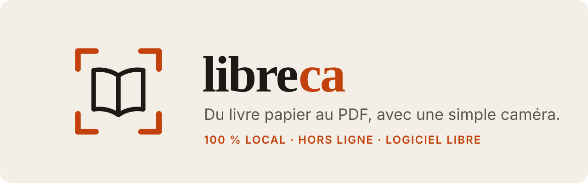
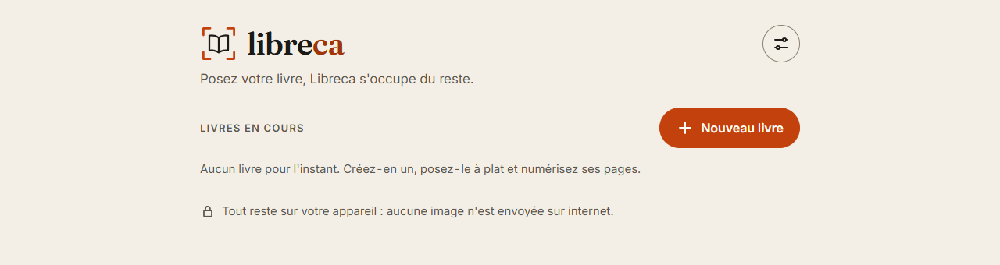
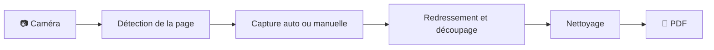

<p align="center">
  <picture>
    <source media="(prefers-color-scheme: dark)" srcset="docs/images/banner-dark.svg">
    
  </picture>
</p>

<p align="center">
  <a href="https://difabiolorenzo.github.io/libreca/"></a>
  
  <a href="LICENSE"></a>
  
  
</p>

# Libreca

Libreca transforme un livre papier en PDF à partir d'une caméra. On pose le livre, l'application repère la page dans l'image, la photographie, la redresse et assemble le tout en un PDF qui se lit comme un livre numérique.

Le nom vient de *libre* (le logiciel libre, et « livre » en espagnol), avec « cam » pour caméra. Se prononce « libréka ».

Le projet en est à ses débuts (v0.2) : la détection de page, la capture automatique (page immobile, nette, sans doigt sur le texte, différente de la précédente) ou manuelle, le découpage des doubles pages à la reliure, le redressement, l'ajustement des coins et l'export PDF fonctionnent, le reste est à venir.

## Aperçu

<p align="center">
  <picture>
    <source media="(prefers-color-scheme: dark)" srcset="docs/images/bibliotheque-nuit.png">
    
  </picture>
  <br>
  <em>La bibliothèque, en thème Papier (ou Nuit selon les réglages de votre système).</em>
</p>



## Fonctionnalités prévues

- Plusieurs sources vidéo : caméra du téléphone, webcam, carte de capture, fichier vidéo.
- Capture automatique dès que la page est stable et nette.
- Redressement de la perspective et correction de la courbure des pages.
- Découpage automatique des pages gauche et droite.
- Nettoyage : fond blanc, ombres, contraste, couleur ou noir et blanc.
- Effacement des doigts par IA, en module optionnel qui fonctionne hors ligne.
- OCR optionnel, pour pouvoir chercher du texte dans le PDF.
- Export PDF avec des pages de taille uniforme.

## Principes

- Tout se passe sur l'appareil, hors ligne : aucune image n'est envoyée nulle part.
- Un seul code pour Windows, Linux, macOS et Android.
- Chaque traitement fonctionne d'abord sans IA, avec de la vision par ordinateur classique (OpenCV). L'IA ne vient qu'en complément, sous forme de module léger et facultatif.
- Logiciel libre.

## Architecture (prévue)

Une application web installable (PWA) qui fait tout le traitement dans le navigateur :

| Rôle | Technologie |
|---|---|
| Interface | HTML, CSS et JavaScript natifs (modules ES, sans build) |
| Vision classique | OpenCV.js (WebAssembly) |
| Détection des mains | MediaPipe Hand Landmarker |
| IA (effacement) | ONNX Runtime Web + LaMa (version légère) |
| OCR | Tesseract.js |
| PDF | générateur maison (v0.1), pdf-lib envisagé |
| Stockage local | IndexedDB / OPFS |
| Paquets natifs | Tauri (PC), Capacitor (Android) |

## Démarrer

Prérequis : [Node.js](https://nodejs.org/) 20.12 ou plus récent, utilisé seulement pour le serveur de développement (aucune dépendance npm à installer).

1. Lancer le serveur local : `npm start` (ou `node tools/serve.mjs`).
2. Ouvrir http://localhost:8080/ dans le navigateur.

Sans rien installer, la dernière version publiée est aussi en ligne : https://difabiolorenzo.github.io/libreca/ (GitHub Pages, en HTTPS, donc la caméra fonctionne aussi sur téléphone).

Avec un serveur Apache (WAMP, XAMPP…), le fichier `.htaccess` fourni désactive le cache (module `mod_headers` requis, actif par défaut sous WAMP) : sans lui, le navigateur peut garder une ancienne version du Web Worker et la mélanger avec la nouvelle page, ce qui fait échouer la capture.

Un service worker (`sw.js`) revérifie chaque fichier auprès du serveur à chaque chargement, quelles que soient ses règles de cache (GitHub Pages garde les fichiers 10 minutes), et garde une copie pour ouvrir l'application hors ligne.

### Utiliser un téléphone Android comme caméra

1. Brancher le téléphone au PC en USB.
2. Sur le téléphone, dans la notification « Charge via USB », choisir le mode « Webcam » (Android 14 ou plus récent).
3. Sur le PC, lancer `npm start`, ouvrir http://localhost:8080/ et choisir le téléphone comme caméra dans l'écran de capture.

Il est aussi possible d'ouvrir l'application directement sur le téléphone en Wi-Fi : la caméra exige alors HTTPS. Créer un certificat auto-signé une fois, lancer `npm run start:lan` et ouvrir l'adresse `https://192.168.x.x:8080/` affichée, en acceptant l'avertissement du navigateur.

```sh
mkdir .cert
openssl req -x509 -newkey rsa:2048 -nodes -days 365 -keyout .cert/key.pem -out .cert/cert.pem -subj "/CN=libreca-dev"
```

Sous Windows, `openssl` est fourni avec Git Bash ; y écrire `-subj "//CN=libreca-dev"` (deux barres obliques). Le dossier `.cert/` est ignoré par Git.

### Tests

`npm test` (ou `node --test`) vérifie notamment que toutes les clés de traduction utilisées existent dans le dictionnaire français, la détection de page et le redressement (sur des images de synthèse, avec OpenCV.js chargé dans Node) et le générateur de PDF.

## Feuille de route

Voir [TODO.md](TODO.md).

## Contribuer

Les idées et retours sont les bienvenus via les issues.

## Utilisation de l'IA dans le développement

Le code et la documentation de Libreca sont écrits avec l'aide d'assistants d'IA (notamment Claude, via Claude Code). Chaque modification est relue, testée et validée par le mainteneur avant d'être intégrée. Ceci concerne uniquement le développement : l'application elle-même ne dépend d'aucun service d'IA en ligne.

## Licence

[Mozilla Public License 2.0](LICENSE). Les fichiers de Libreca modifiés et distribués doivent rester publics, mais Libreca peut être intégré dans d'autres projets.

Bibliothèques tierces incluses dans `src/vendor/`, chacune avec sa propre licence :

- [OpenCV.js](src/vendor/opencv/) 5.0.0 : Apache-2.0.
- [Polices](src/vendor/fonts/) Fraunces et Inter (sous-ensembles WOFF2) : SIL OFL 1.1.
